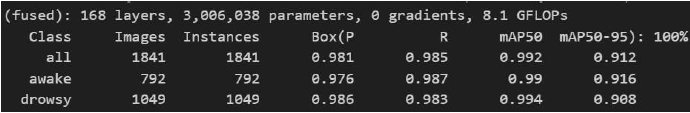

# 🚘 Driver Drowsiness Detection System

The aim of this project is to demonstrate webcam-based driver drowsiness monitoring with a responsive dashboard and software-only driving scene. It monitors facial features, eye behavior, and posture; it does not control a real vehicle or connect to CARLA.

---

## 🧠 Project Logic and Detection Strategy

The live `main.py` runtime uses `dlib` facial landmarks for eye, mouth, and
head-pose measurements. Personal calibration and a short rolling median reduce
pose noise; a separate full-body pose pass is not run on every webcam frame.
The YOLOv8 training notebook and model-performance notes are separate research
material and are not used by this webcam runtime.

### 🔶 Sub-Algorithms – Fine-Grained Level Evaluation
The runtime estimates the **severity level** from live facial measurements:

| Module              | Description                                      | Tool Used     |
|---------------------|--------------------------------------------------|----------------|
| `EAR / PERCLOS` | Tracks eye geometry, blinks, and eye closure over time | `dlib` + `OpenCV` |
| `Mouth aperture` | Measures sustained open-mouth/yawn patterns | `dlib` + `OpenCV` |
| `Head pose` | Estimates pitch, yaw, and roll relative to the calibrated neutral pose | `dlib` + `OpenCV` |

The live webcam also tracks Eye Aspect Ratio (EAR), blink rate, mouth aperture,
yawns, and continuous eye-closure duration. Eye measurements can be calibrated
for the current driver to accommodate different eye sizes. Euclidean EAR is
resistant to image-plane head roll, while pose and facial roll contribute to
the displayed head-deviation signal. If face/eye tracking is unreliable, the
dashboard reports uncertainty rather than counting missing measurements as
closed eyes; unavailable pose measurements are not used as warning evidence.

---

## 📊 Drowsiness Levels & System Actions

The system estimates four drowsiness states from eye closure, PERCLOS, yawns,
and sustained pitch/roll deviation from the calibrated head pose. Warnings
escalate in frequency and tone pattern with severity.

| Level | Example evidence | Action |
|-------|------------------|--------|
| 0 | Low PERCLOS, no prolonged closure | Attentive status |
| Level 1 | Increasing eye closure, yawns, or head deviation | Periodic caution beep and dashboard update |
| Level 2 | Higher PERCLOS, repeated yawns, or prolonged closure | Faster warning beep and high-risk status |
| Level 3 | Severe PERCLOS, head deviation, or prolonged closure | Urgent warning and severe status |

---

## 🎮 Interactive Software Driving Simulation

The dashboard shows an illustrated driver seated in a cabin with a steering
wheel, dashboard, windshield, side windows, mirror, and an animated road. The
illustration is a simulation character, **not** the person detected by the
camera. The road can be switched between day/night and clear/rain/fog. During
the parking demonstration, simulated speed falls to zero, hazards activate,
and the interface records the stop; no vehicle, steering, or braking hardware
is connected.

Defaults are **35 seconds** of continuous eye closure for the critical beep and
**45 seconds** of continuous eye closure or no response to an active warning
for simulated parking. These values can be changed in Settings for testing;
they are demonstration requirements, **not safe real-world reaction times**.
Sound volume also depends on the computer's audio settings. This is not a
validated driver-safety product.


*Reference image: simulation illustration; it is not connected to the live app.*

---

## 🧠 Model Training & Performance (YOLOv8n)

The facial state classifier was trained using **Ultralytics YOLOv8n** on a **custom Roboflow dataset** with 9600+ images:

- Classes: `Awake`, `Drowsy`
- Training environment: Google Colab (GPU-enabled)
- Image size: 640x640
- Epochs: 50

To download the Roboflow dataset from `training_model.ipynb`, set the
`ROBOFLOW_API_KEY` environment variable before running its download cell. Do not
store API keys in the notebook.

### 📈 Evaluation Metrics

| Metric       | Awake Class | Drowsy Class |
|--------------|-------------|--------------|
| mAP50        | 99.0%       | 99.4%        |
| mAP50-95     | 91.6%       | 90.8%        |


*Figure 2: Summary of our model performance at epoch 50.*

---

## 🖥️ Interface – PyQt5 Widescreen HMI

The widescreen dashboard acts as the human-machine interface (HMI) for this system:

- Real-time display of:
  - Camera tracking status and live driver video
  - EAR, PERCLOS, blink rate, mouth aperture, yawn count, and head deviation
  - Escalating status and event history, including current eye-closure, yawn,
    and head-deviation values during warnings
- **Calibrate eyes + pose** runs a guided 60-second personalization session:
  use your usual comfortable driving posture throughout; do not straighten a
  naturally bent head just for calibration. The first 30 seconds learn that
  habitual head angle and your open-eye EAR, with natural blinks prompted.
  Gentle glances and tilts are prompted in the middle, and the final seconds
  ask you to return to your usual posture. Those prompted movements are
  excluded from the baselines. Eye samples set an individualized open-eye EAR
  reference and closure threshold, including lower valid EAR baselines down to
  0.05. The sensitivity setting adjusts the closure cutoff while keeping it
  below the learned open-eye baseline, so high sensitivity cannot classify the
  baseline itself as closed. Deliberate long eye closures or yawns are not
  calibration targets. The progress bar shows each instruction and time.
  Valid eye/posture sample counts appear during the session and in the final
  result so an incomplete calibration can be retried with better tracking.
  Sustained calibrated pitch/roll deviations escalate at 12°, 22°, and 32°,
  with a 5-second grace before the first sound and slower escalation at 8 and
  12 seconds.
  Continuous eye closure uses the same 5/8/12-second warning stages; PERCLOS
  stays unavailable until nearly a full 15-second reliable tracking window is
  collected, avoiding an inflated startup percentage from a single blink.
  Pitch/yaw/roll and a bend reference percentage are displayed with the other
  live metrics; hover over EAR to view the personal baseline and closure
  threshold. Calibration reports failure if it could not capture enough
  reliable face samples.
- **Start webcam / Pause / Resume / Stop** control the live camera explicitly.
  The live feed is mirrored, with a translucent triangular wireframe drawn
  across the face. Jaw, brows, eyes, and lips have contrasting colored
  contours; this lightweight mesh uses the 68 dlib landmarks, not MediaPipe's
  dense 468-point face mesh. Fine, anti-aliased lines keep the camera image
  visible beneath the overlay. When the frontal detector misses a rolled face,
  it retries at a small set of image rotations. The neck/shoulder overlay is
  an estimated guide derived from face geometry, not a separately detected
  neck landmark or posture model.
- Camera-check guidance helps troubleshoot tracking: it suggests improving
  front lighting when the image is very dim, moving closer when the detected
  face is small, recentering when it is far off-center, and checking camera
  framing/obstructions when no face is found. It does not infer sleep from
  tracking loss, and its lighting/frame checks are practical hints rather than
  a guarantee that glasses, occlusion, or every camera condition are handled.
  The spoken “Please set the camera properly” reminder is limited to a face not
  found / partly out of frame for 5 continuous seconds, then plays twice once
  for that loss episode. Off-center and dim-light guidance stays visual. The
  reminder follows the Sound setting and runs separately from the UI thread.
- **Full camera / Face close-up** switches between the full webcam view and a
  crop centered on the detected face. Close-up changes only the preview; the
  detection continues to use the unmodified camera frame. If a face is not
  currently tracked, the preview automatically returns to the full view.
  The camera feed and illustrated driver remain separate, and the driving
  scene is labeled as an illustration rather than live detection. The dashboard window
  sizes itself to the available screen and keeps the metric/event areas clear
  instead of letting the camera preview overlap their controls.
- **Check tracking** runs a short guided, live-camera diagnostic across the
  driver's usual posture, natural eye shape/blinks, gentle glances and head
  bends, and usual glasses if worn. It reports face/eye and pose-landmark
  coverage per step without recording frames. Use the results to find framing
  or lighting problems; this check is diagnostic only and does not validate
  safety or guarantee performance for every person.
- Compact metric cards keep the EAR ratio and the other live values visible on
  smaller dashboard sizes. Head pose is displayed as pitch/yaw/roll values;
  percentage and angle values are rounded for readability; hover over pose
  and metric cards for their full descriptions.
- Live pose displays approximate pitch, yaw, and roll from facial landmarks.
  After calibration these are deviations from the driver's neutral pose.
  Tracking loss is shown as uncertainty; missing face/eye measurements are
  never shown as closed eyes.
- The face wireframe and jaw are cyan; open eyes use contrasting blue/purple,
  closed eyes turn red, and the lips are highlighted cyan/amber. A brief blink
  or head movement is kept quiet: continuous eye closure and calibrated head
  pitch/roll deviation wait 5 seconds before the first warning, then escalate
  at 8   and 12 seconds if they continue. Repeated mouth open/close motion is treated
  as likely talking and does not count as a yawn while eyes remain tracked;
  eye-closure warnings remain active. PERCLOS does not bypass that grace
  while eyes are continuously closed; its rolling signal can still warn when
  the eyes reopen after the 15-second window is established. Yawning and
  repeated blink/PERCLOS patterns remain separate drowsiness cues. Looking
  sideways alone is not treated as head droop.
- **I'm alert** records the driver's response. It does not override live
  measurements; it restarts the unanswered-warning timer. **Reset alert
  state** only clears after recovery and refuses to clear active risk or
  uncertain tracking.
- **Settings / help** configures sensitivity, blink/yawn thresholds, demo
  timeouts, critical beep interval, sound, and accessibility options. Select
  standard, 115%, or 130% text sizing and high contrast; the choices apply to
  live status labels as well as the dashboard and settings dialog.
- **Privacy controls** can hide the live camera preview while clearly keeping
  local analysis active; pausing or stopping the webcam halts frame processing,
  and Stop releases the camera. Frames/video are never recorded or exported.
  Events and aggregate session data stay in memory unless the user explicitly
  exports a JSON report; that report contains counts, tracking coverage, and
  timestamped event messages, but no images or raw facial measurements. The
  in-memory history can be cleared from Settings and is discarded when the app
  closes.
- **Session summary / Export JSON** shows session duration, warning and
  simulated-stop counts, live face/eye coverage, the latest guided tracking
  check, and timestamped events. Export is explicit and opens a save dialog;
  event history is bounded to the most recent 1,000 records, and the summary
  marks when older events have been trimmed. This diagnostic report is not a
  safety certification.
- Interactive controls support keyboard focus. Use Tab/Shift+Tab to navigate,
  Enter or Space to activate a control, F1 for Help, F8 to test sound, and Esc
  to close the dashboard. Settings lists these shortcuts.
- **Run test scenario** injects labeled test-only values for normal driving,
  mild drowsiness, eye closure, yawning, head tilt, tracking loss, alert
  escalation, unresponsiveness, recovery, and parking. **Accelerated test**
  advances the demo clock so the 35/45-second flow can be reviewed quickly.
  Test values are explicitly marked and do not masquerade as webcam data.
- **Simulate Emergency Parking** manually previews the stop; reset the drive
  scene to restart it. The event timeline includes timestamps and session
  warning/stop counts.
- Eye contours are cyan while open and red while closed; mouth landmarks are
  amber. Labels are drawn with a dark outline for contrast. Dashboard metric
  values use larger bold type.
- Audio warning tones increase in digital amplitude and become faster/more
  urgent with severity. Critical beeps are repeated without blocking camera/UI
  processing. The app does not override Windows master volume; adjust the
  computer's sound level if needed.
- If the webcam is unavailable, the software driving demonstration still runs.
- Webcam and landmark processing run outside the GUI thread so controls and
  simulation remain responsive while frames are analyzed.
- Developed with **PyQt5**


*Figure 3: Driver drowsiness detection displayed on the widescreen interface*

---

## 📦 Project Structure

```bash
main.py                         # Webcam capture and detection integration
wideScreen.py                   # Dashboard and software-only driving scene
perclos_calculation.py          # EAR, PERCLOS, blink, and yawn measurements
posture_deviation.py            # Optional standalone MediaPipe posture utility
requirements.txt                # Python runtime dependencies
shape_predictor_68_face_landmarks.dat
                                # Required dlib facial landmark model
```

## 🛠️ Installation

### ✅ Requirements

- Python 3.11 recommended (the project runtime was exercised with Python 3.11.9)
- `opencv-python`
- `dlib`
- `mediapipe`
- `PyQt5`
- `numpy`
- `scipy`
- `ultralytics` / `torch` are only needed for separate training materials.
- CARLA is not required or used by this dashboard.

---

## ⚙️ Setup

From PowerShell in the project folder:

```powershell
py -3.11 -m venv .venv
.\.venv\Scripts\python.exe -m pip install --upgrade pip
.\.venv\Scripts\python.exe -m pip install -r requirements.txt
.\.venv\Scripts\python.exe main.py
```

The dlib model file `shape_predictor_68_face_landmarks.dat` must be present
beside `perclos_calculation.py` (it is included in this project). On Windows,
`dlib` may require a compatible prebuilt wheel or C++ build tools if pip cannot
install it for the selected Python version. Allow camera access when prompted.
If the camera is unavailable, the dashboard remains usable for labeled
simulation tests and parking demonstrations; webcam metrics will not be
fabricated.

## 👨‍🔬 How to Test

### Automated safety checks

From the project folder in PowerShell, run the deterministic checks without
opening a camera:

```powershell
.\.venv\Scripts\python.exe -m unittest discover -s tests -v
```

The suite covers calibration sample reporting, personalized eye thresholds,
tracking-loss timer resets, the 5-second camera-reminder gate, conversation
mouth-motion filtering, delayed eye/head warnings, alert acknowledgement,
sustained head deviation, and software-only emergency-parking triggers. The
suite stubs the face detector and does not require a webcam; it does not
validate real face-landmark detection or physical audio output.

### Live webcam

```bash
python main.py
```

Start the webcam in the dashboard, run the guided one-minute calibration and
follow its on-screen posture/blink/turn/tilt prompts, then verify the camera
status, personalized EAR reference, landmark overlay, and changing EAR,
blink, mouth, and pose values. Test tracking loss by moving out of frame;
re-center to verify recovery. Repeat with different lighting, glasses, eye
shapes, and gentle head turns/tilts. Results can vary with camera placement
and image quality.

### Labeled test scenarios

Select each scenario and leave **Accelerated test** enabled to check the
dashboard without waiting for real-time thresholds:

1. Normal attentive driving — green status and no alert.
2. Mild drowsiness — caution status and gentle warning.
3. Repeated yawning and head tilt — metrics/status update.
4. Prolonged eye closure / critical alert escalation — critical red state and
   repeated urgent beeps once the configured eye-closure limit is crossed.
5. Unresponsive driver — automatic parking begins after the configured
   no-response timeout (eye closure may also independently reach its limit).
6. Recovery after opening eyes — alert clears and the closure timer resets.
7. Face tracking loss — uncertainty is shown, not closed eyes.
8. Emergency parking — verify deceleration, stopped status, timestamped event,
   then reset the scene and try the manual parking button.

Disable **Accelerated test** to experience scenario timing at normal speed.
These are mock detection inputs and are marked as simulated, not webcam
measurements.

### Simulation-only window

```bash
python wideScreen.py
```

This opens the illustrated simulation UI without a webcam worker.

### ☁️ Google Colab Inference

1- Open the Colab notebook.

2- Upload your video.

3- Run yolov8_detect.ipynb to perform facial state detection and overlay labels.

## 🌐 References

- https://carla.org/
- https://github.com/ultralytics/ultralytics
- https://roboflow.com/
- https://academic.oup.com/sleepadvances/article/4/1/zpad006/7000589
